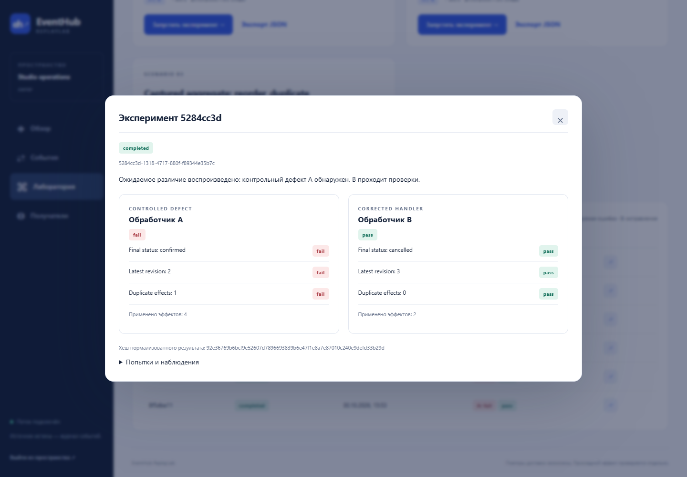

# EventHub ReplayLab

**Durable event delivery and reproducible failure replay with a verified A/B result.**

[Русский](README.md) · **English** · [Architecture](docs/ARCHITECTURE.en.md) · [Verification](docs/VERIFICATION.en.md) · [MIT](LICENSE)

A cancelled booking becomes confirmed again: an older snapshot arrives late,
and a network retry repeats an already committed effect. EventHub preserves the
delivery history; ReplayLab runs the incident against an intentionally faulty A
and a corrected B, then checks their actual database state.



| Incident | A: controlled defect | B: corrected handler |
| --- | --- | --- |
| Snapshots 1 → 3 → 2 → 2 | Reverts state and duplicates an effect | Keeps revision 3 and deduplicates |
| HTTP response lost after commit | Repeats the committed action | Recognizes the original event ID |

## Run locally

Requirements: Linux/WSL, Python 3.10+ for the standard-library launcher and an
existing Docker Engine with Compose ≥ 2.24.4. Application Python 3.14 runs inside
the image; a host virtual environment is not required for the demo. Tested on x86_64.

```bash
git clone https://github.com/Sasambatra/eventhub-replaylab.git
cd eventhub-replaylab
python3 scripts/stack.py start
```

Open [localhost:8100](http://127.0.0.1:8100). Copy `key` from the generated private
`.local/owner-access.txt` into the login form. Open **Лаборатория** (Laboratory),
run either case and inspect its report. The dashboard is in Russian; the report
rules and API contracts use English. An expected A failure demonstrates the bug;
B must pass. Requests, database transactions and timeouts are real.

The launcher creates random settings, builds the pinned image, migrates the
three databases and waits for API readiness. Re-running preserves data and the
owner key. `python3 scripts/stack.py stop` preserves volumes. The first run needs
network access for pinned images/wheels, several GiB available RAM and free port 8100.
Docker may require sudo; the launcher also supports the existing Ubuntu/WSL engine.

## Documentation

[English guides](docs/README.en.md) · [Five-minute demo](docs/DEMO.en.md)

## Engineering decisions

- Persist Event + delivery plan + transactional outbox before HTTP acceptance.
- Use RabbitMQ quorum queues, publisher confirms and acknowledgement after commit.
- Keep network calls outside database transactions; fence stale workers using
  lease tokens and generations. Retry with bounded attempts/TTL/Retry-After.
- Preserve event identity on retry; keep manual delivery runs separate.
- Isolate prepared receiver databases and replay namespaces. Resume a runner
  through a committed invocation ledger without hiding deliberate event duplicates.
- Check final status/revision/duplicate effects rather than equating HTTP 200
  with correct application behaviour.

Transport is bounded at-least-once. Receiver B's transaction and full-snapshot
revision contract prevent duplicate effects locally; this is not a global
exactly-once claim or a test harness for arbitrary third-party services.

## Evidence and review

42 tests cover contracts, concurrency, authorization, real database/broker/HTTP
failure windows, manual history, retention, runner recovery and generated message
sequences with Hypothesis. Fresh-volume startup, broker outage, receiver isolation,
backup restoration and responsive-browser flows were checked separately.
[Verification details](docs/VERIFICATION.en.md) · [Run checks](CONTRIBUTING.md).

Start a code review with [services](eventhub/services.py),
[worker](eventhub/worker.py), [replay](eventhub/replay.py),
[receivers](lab/app.py) and [delivery tests](tests/test_delivery.py).
The optional [Django source adapter](adapters/booking_source/README.md) is disabled
by default; the EventHub demo runs independently.

Python 3.14, FastAPI, PostgreSQL 18, RabbitMQ, SQLAlchemy/Alembic, OpenTelemetry,
pytest/Hypothesis and Docker Compose. Dependencies have hash locks; images have
digests. See [CI](https://github.com/Sasambatra/eventhub-replaylab/actions/workflows/check.yml).

## Scope

A local demonstration with one snapshot event type, one aggregate per case and
two prepared receivers. No arbitrary URLs/code, public mode, hosted demo, real
payment/email effects or persistent trace backend. Localhost is not a public URL.
[Security](SECURITY.md) · [Operations](docs/OPERATIONS.en.md) · [MIT license](LICENSE).
