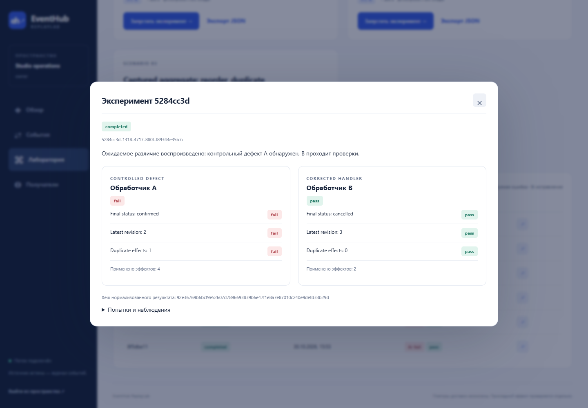
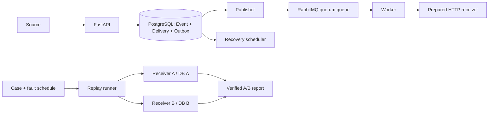
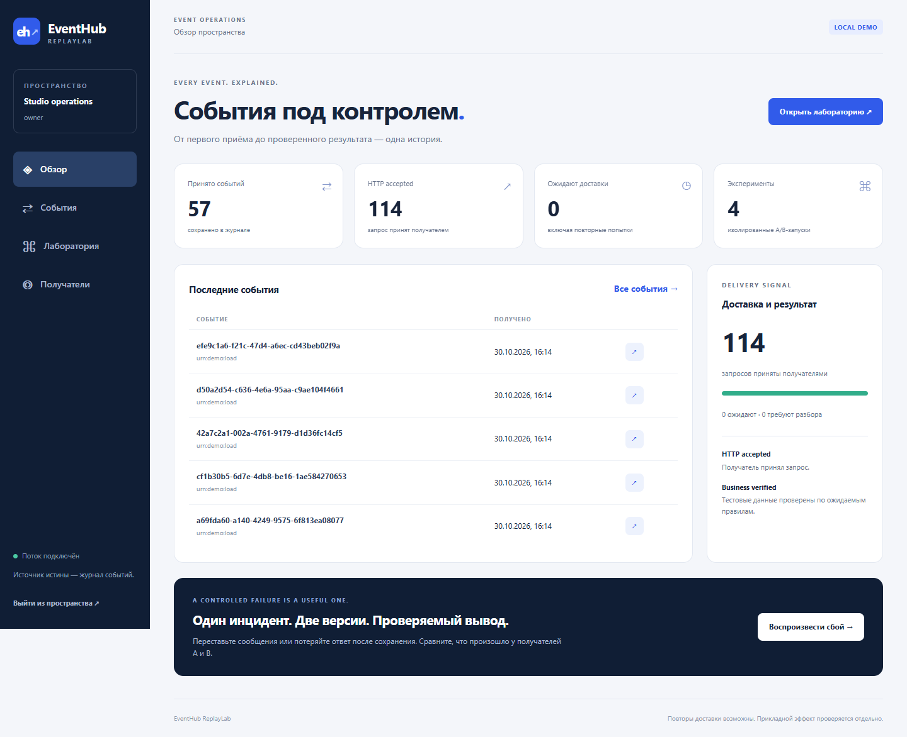

# EventHub ReplayLab

[](https://github.com/Sasambatra/eventhub-replaylab/actions/workflows/check.yml)
[](LICENSE)

**Доставка событий и воспроизведение сбоев с проверкой результата на двух версиях обработчика.**

[English](docs/README_EN.md) · [Демонстрация](docs/DEMO_RU.md) · [Архитектура](docs/ARCHITECTURE.md) · [Проверки](docs/VERIFICATION.md) · [MIT](LICENSE)

Отменённая запись снова стала подтверждённой: старое сообщение пришло позже нового,
а сетевой повтор применил действие ещё раз. EventHub сохраняет историю доставки;
ReplayLab воспроизводит такой инцидент на контрольном обработчике A и исправленном B.
Результат проверяется по состоянию их баз, отдельно от ответа HTTP.



## Что посмотреть за минуту

| Сценарий | A: контрольный дефект | B: исправленная версия |
| --- | --- | --- |
| Снимки 1 → 3 → 2 → 2 | Возвращает старый статус, повторяет эффект | Сохраняет версию 3 и распознаёт повтор |
| Ответ потерян после commit | Повторяет уже выполненное действие | Возвращает результат исходного события |

В лаборатории работают настоящие HTTP-запросы, таймауты и отдельные PostgreSQL-базы.
Ожидаемый `fail` версии A — подтверждение воспроизведённого дефекта; B должна дать `pass`.
[Пример сохранённого результата](docs/evidence/replay-reordered.json).

## Быстрый запуск

Нужны **Linux/WSL, Python 3.10+ для скрипта запуска и уже установленный Docker
с Compose ≥ 2.24.4**. Python 3.14 и зависимости приложения устанавливаются внутри
контейнера; локальная `.venv` для демонстрации не требуется. Проверенная сборка — x86_64.

```bash
git clone https://github.com/Sasambatra/eventhub-replaylab.git
cd eventhub-replaylab
python3 scripts/stack.py start
```

Откройте **[http://127.0.0.1:8100](http://127.0.0.1:8100)**. Для входа возьмите
значение `key` из созданного приватного `.local/owner-access.txt`.
В **Лаборатории** выберите сценарий → **Запустить сравнение** → откройте результат.

Скрипт создаёт случайные настройки, собирает образ, запускает базы и брокер,
применяет миграции и ждёт готовности API. Повторный запуск сохраняет данные/ключ.
Docker вызывается напрямую при доступе к сокету, иначе через sudo; в текущем
Ubuntu/WSL поддержан существующий root-вызов Docker через wsl.exe.

```bash
python3 scripts/stack.py status   # Состояние контейнеров
python3 scripts/stack.py stop     # Остановка с сохранением данных
```

Первый запуск скачивает закреплённые образы/пакеты. Порты 8100 и 18100 должны
быть свободны для основного стенда и отдельной проверки соответственно.
Требуется несколько GiB свободной RAM. [Подробный запуск и диагностика](docs/OPERATIONS.md).

## Как устроена доставка



- **Сначала сохранение.** Event и план доставки/outbox фиксируются одной транзакцией;
  недоступный брокер не теряет уже принятое событие.
- **Повтор — обычная ситуация.** Стабильный event ID/хеш отличает повтор от конфликта;
  новое ручное выполнение получает отдельную историю.
- **Работник может опоздать.** Lease token/generation ограждают состояние от старого
  результата; сеть и ожидания выполняются вне транзакции БД.
- **Подтверждение имеет границу.** HTTP accepted означает приём запроса. Только
  лабораторное наблюдение позволяет проверить прикладной результат.

Транспорт — bounded at-least-once: запрос может повториться, срок и число попыток
ограничены. B объединяет receipt и изменение одной транзакцией и проверяет версию
полного снимка. Глобальная exactly-once и корректность произвольного внешнего API
не заявляются. [Решения и компромиссы](docs/ARCHITECTURE.md).

## Реализовано

**Надёжность:** outbox, publisher confirms, ack после commit, аренды/восстановление,
Retry-After/backoff/TTL, квоты, история попыток и ручных запусков.

**Лаборатория:** перестановки, повторы, 429/500, задержка и потеря ответа после commit;
контрольные точки, отмена, фиксация версии обработчика, нормализованный A/B-отчёт,
создание обезличенного сценария из событий, JSON import/export с checksum.

**Доступ и эксплуатация:** project/scopes/source, роли и сроки ключей, отзыв,
HttpOnly-сессии/CSRF/CSP, SSE, защищённые метрики, OpenTelemetry Collector,
retention, backup/restore drill, Docker Compose.

**Источник:** [outbox-адаптер Django Salon Booking](adapters/booking_source/README.md)
с минимальными снимками UUID/версия/статус. Он выключен по умолчанию; EventHub
работает самостоятельно, клонировать сайт бронирования для демонстрации не нужно.



## Проверки и код для просмотра

**42 автоматических теста:** реальные PostgreSQL/RabbitMQ/HTTP, конкурентные запросы,
конфликты/права, потеря confirm/ack, истечение аренды и запоздавший работник,
восстановление replay, retention, Hypothesis-последовательности сообщений.

Дополнительно проверены пустые тома, изоляция получателей, отключение брокера,
восстановление трёх баз и интерфейс на 1440/768/375 px.
[Условия и результаты](docs/VERIFICATION.md). [Как запустить проверки](CONTRIBUTING.md).

| Что оценить | Где смотреть |
| --- | --- |
| Транзакция приёма и дедупликация | [services.py](eventhub/services.py) |
| Claims, fencing, публикация, восстановление | [worker.py](eventhub/worker.py), [delivery tests](tests/test_delivery.py) |
| Воспроизводимый runner и сравнение | [replay.py](eventhub/replay.py), [replay tests](tests/test_replay.py) |
| Транзакционный эффект A/B | [lab/app.py](lab/app.py) |
| Авторизация и вход | [security.py](eventhub/security.py), [API tests](tests/test_api.py) |

Python 3.14 · FastAPI · SQLAlchemy/Alembic · PostgreSQL 18 · RabbitMQ · HTTPX ·
OpenTelemetry · pytest/Hypothesis · Docker Compose. Lock-файлы содержат хеши,
образы закреплены по digest. Изменения проверяет [GitHub Actions](https://github.com/Sasambatra/eventhub-replaylab/actions/workflows/check.yml).

## Границы

Это локальный демонстрационный продукт: один тип полных снимков, один объект в
сценарии, два подготовленных получателя. Произвольные URL/код и публичный режим
выключены. Публичного сервера нет; localhost-ссылка работает после локального запуска.
Долговременное хранилище трасс, внешние платежи/почта и публичная инфраструктура
не входят в эту версию. [Security](SECURITY.md) · [API](docs/API.md) ·
[Изменения](CHANGELOG.md) · [Описание для резюме](docs/DEMO_RU.md#для-резюме).

MIT © [Sasambatra](https://github.com/Sasambatra).
